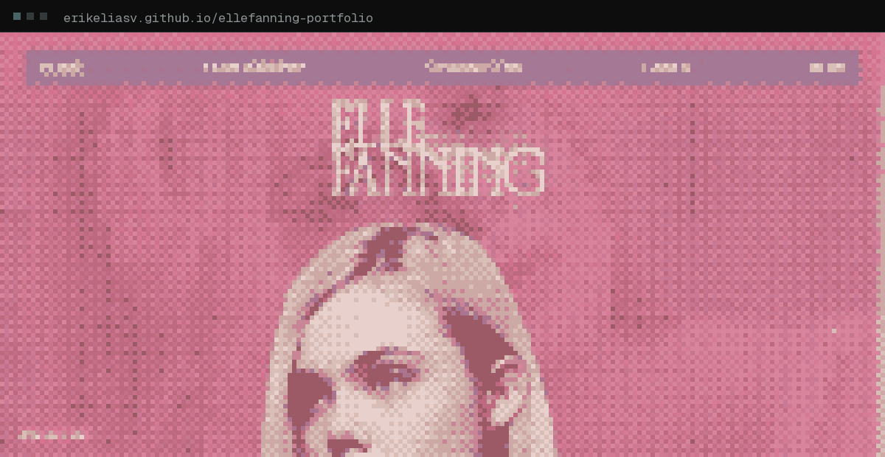
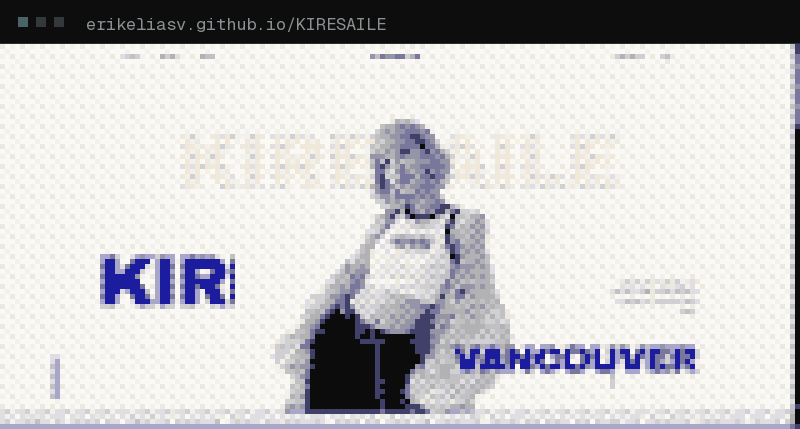
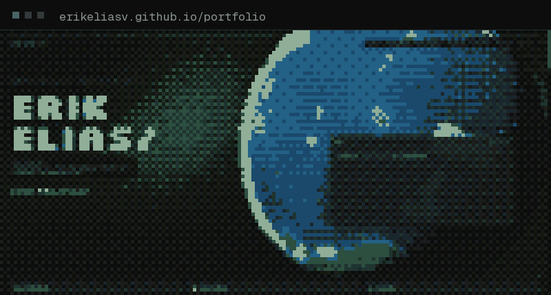
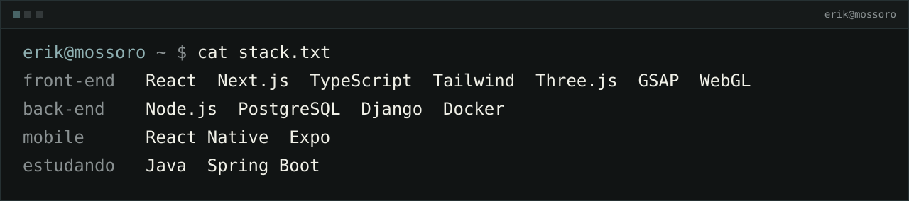

  &nbsp;
  

<h3>
  <picture>
    <source media="(prefers-color-scheme: dark)" srcset="./assets/t-sobre-dark.svg">
    
  </picture>
</h3>

Sou o Erik, desenvolvedor front-end e full stack em Mossoró, RN. Construo produtos web do zero, de sistemas de gestão a interfaces 3D com Three.js e WebGL. No dia a dia uso React, Next.js, TypeScript e Node.js.

Desde agosto de 2026 sou o desenvolvedor da The GRAW Design, estúdio de design do André Gonçalves, como freelancer. Também procuro uma vaga remota de front-end, e vagas full stack me interessam. Se você está contratando, me chama no [LinkedIn](https://www.linkedin.com/in/erikeliasv/).

Curso Ciência da Computação na UnP, com conclusão prevista para 2027, e estou estudando Java e Spring Boot por conta própria. Antes de programar, trabalhei no atendimento da Claro, num call center de alto volume. Foi lá que aprendi a resolver problema de cliente irritado sem perder a calma.

<h3>
  <picture>
    <source media="(prefers-color-scheme: dark)" srcset="./assets/t-experiencia-dark.svg">
    
  </picture>
</h3>

| Quando | Onde | O que fiz |
| --- | --- | --- |
| ago 2026 até hoje | The GRAW Design, freelance remoto | Transformo os layouts do estúdio em sites, das animações às cenas em WebGL. Agora estou fazendo a loja da Naturallis em Next.js 16, Tailwind 4, GSAP e Three.js, incluindo o SEO técnico, e o novo site do estúdio, com um efeito de dithering em WebGL nas imagens. Também montei o CI dos dois projetos, que roda lint e checagem de tipos antes de cada deploy. |
| jul 2025 a fev 2026 | i9 Systemas | Dev front-end júnior numa startup de software de gestão para empresas de construção civil. Construí o front-end do produto praticamente do zero junto com o time de back-end: mais de 15 telas em Next.js, TypeScript e Tailwind, todas alimentadas pela API REST, com Zod na validação e Context API no estado. |
| abr a jul 2025 | Senac RN | Estágio no Senac Labs Mossoró. Fiz o app mobile que o Senac entregou ao Sindicato de Mossoró, em React Native com TypeScript, e as APIs REST em Node.js com PostgreSQL. |

<h3>
  <picture>
    <source media="(prefers-color-scheme: dark)" srcset="./assets/t-projetos-dark.svg">
    
  </picture>
</h3>

**Portfólio da Elle Fanning** 
Site de fã sobre a carreira da Elle Fanning, com design do André Gonçalves e código meu, sem template. O retrato da home é formado por milhares de cubos 3D (3.726 numa tela 1080p) desenhados numa única draw call com instancing, e eles sobem quando o cursor passa perto. O cursor é uma gota de vidro que refrata a página, e o som roda num motor próprio em Web Audio. Projeto sem fins comerciais. 
Next.js, TypeScript, Three.js, GSAP e Web Audio 
[Ver site](https://erikeliasv.github.io/ellefanning-portfolio/) &nbsp;&nbsp; [Código](https://github.com/ErikEliasV/ellefanning-portfolio)

<table>
  <tr>
    <td width="50%" valign="top">
      
      
<b>KIRESAILE</b> 
      Loja de uma marca fictícia de roupa feminina, com carrinho funcionando. Um fragment shader em WebGL processa o vídeo do tecido em tempo real. O nome é o meu ao contrário: Kire Saile. 
      Next.js 16, TypeScript, Tailwind 4 e WebGL 
      <a href="https://erikeliasv.github.io/KIRESAILE/">Ver site</a> &nbsp;&nbsp; <a href="https://github.com/ErikEliasV/KIRESAILE">Código</a>

    </td>
    <td width="50%" valign="top">
      
      
<b>Portfólio</b> 
      Meu portfólio, refeito em outubro de 2026. Tem um fundo em dither com WebGL e um terminal que vira o site. 
      Next.js 16, TypeScript, Tailwind 4 e WebGL 
      <a href="https://erikeliasv.github.io/portfolio/">Ver site</a> &nbsp;&nbsp; <a href="https://github.com/ErikEliasV/portfolio">Código</a>

    </td>
  </tr>
</table>

#### Sistemas e apps

| Projeto | O que é | Stack |
| --- | --- | --- |
| [DOC Intelligence](https://github.com/ErikEliasV/doc-intelligence-frontend) | Triagem de documentos para escritório de advocacia, feita para uma avaliação técnica de front-end. Os documentos sobem em lote, um modelo de extração lê cada um, e os que ele não tem confiança voltam para conferência humana. A API é mockada. | Next.js 16, React 19, Tailwind 4, Vitest |
| [Pátio BST](https://github.com/ErikEliasV/estacionamento-dsa) ([front-end](https://github.com/ErikEliasV/estacionamento-dsa-front)) | Gerenciador de estacionamento para a disciplina de Estruturas de Dados, com as estruturas escritas do zero em Java. As vagas ficam numa árvore binária de busca e, quando o pátio lota, os carros esperam num min-heap por prioridade (PCD, idoso, gestante, comum). | Java 17, Spring Boot, Next.js 14 |
| [Run Now](https://github.com/ErikEliasV/Run_Now) | Personal trainer virtual de corrida para iniciantes. O plano de treino é gerado no cadastro, e um chat com o Google Gemini guarda o histórico da conversa. | React Native, Expo, Django REST, Gemini |
| [CleanSmart](https://github.com/ErikEliasV/Clean-Smart) | App para a equipe de zeladoria do Senac gerenciar salas, tarefas e rotinas de limpeza, com leitura de QR code pela câmera. | React Native, Expo, TypeScript, NativeWind |

Estudos menores: [detecção de floração de algas](https://github.com/ErikEliasV/a3_computacao_grafica) em imagens de satélite com Python e OpenCV, [Spotify UI Reimagined](https://github.com/ErikEliasV/Spotify-UI-Reimagined) e uma [landing page do BMW X6](https://erikeliasv.github.io/bmw-x6-landing/) ([código](https://github.com/ErikEliasV/bmw-x6-landing)).

<h3>
  <picture>
    <source media="(prefers-color-scheme: dark)" srcset="./assets/t-stack-dark.svg">
    
  </picture>
</h3>

<h3>
  <picture>
    <source media="(prefers-color-scheme: dark)" srcset="./assets/t-atividade-dark.svg">
    
  </picture>
</h3>

