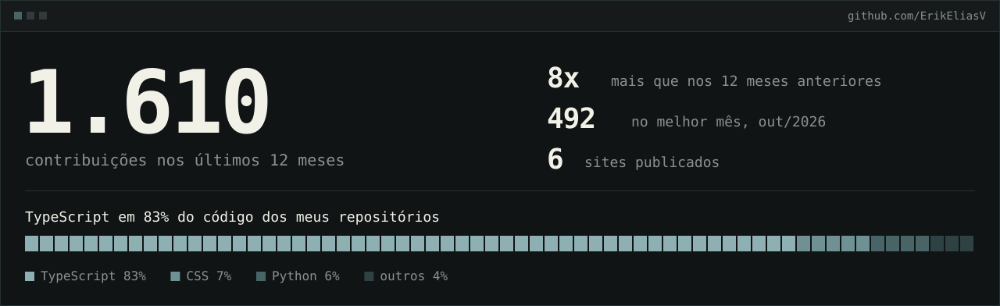

  &nbsp;
  

<h3>
  <picture>
    <source media="(prefers-color-scheme: dark)" srcset="./assets/t-sobre-dark.svg">
    
  </picture>
</h3>

Sou o Erik, desenvolvedor front-end e full stack em Mossoró, RN. Construo produtos web do zero, de sistemas de gestão a interfaces 3D com Three.js e WebGL. Hoje sou freelancer na The GRAW Design e procuro uma vaga remota ou presencial de front-end. Curso Ciência da Computação na UnP, com conclusão prevista para 2027.

<h3>
  <picture>
    <source media="(prefers-color-scheme: dark)" srcset="./assets/t-experiencia-dark.svg">
    
  </picture>
</h3>

| Quando | Onde | O que fiz |
| --- | --- | --- |
| ago 2026 até hoje | The GRAW Design | Transformo os layouts do estúdio em sites, das animações às cenas em WebGL. |
| jul 2025 a fev 2026 | i9 Systemas | Construí o front-end de um sistema de gestão para construção civil, com mais de 15 telas em Next.js. |
| abr a jul 2025 | Senac RN | Fiz o app em React Native que o Senac entregou ao Sindicato de Mossoró, com APIs em Node.js. |

 

<h3>
  <picture>
    <source media="(prefers-color-scheme: dark)" srcset="./assets/t-atividade-dark.svg">
    
  </picture>
</h3>

